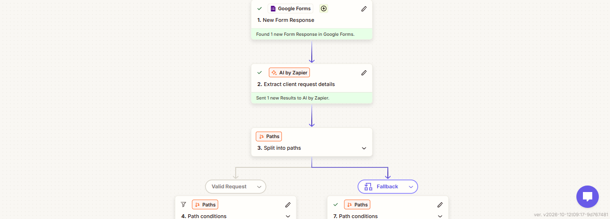
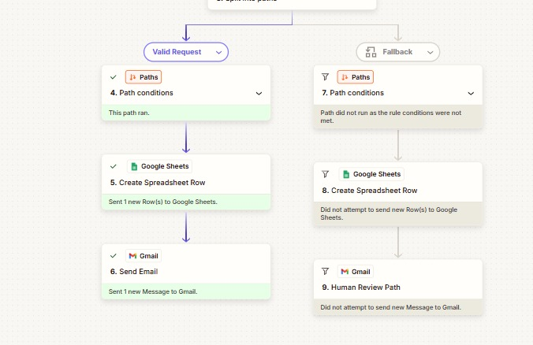
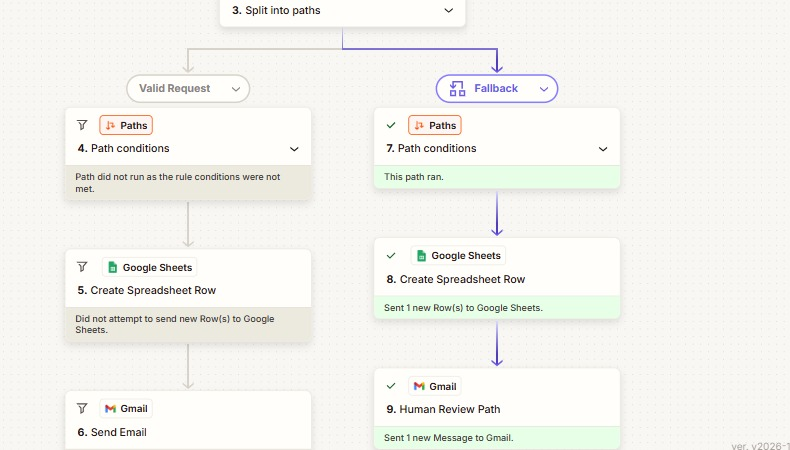

# 🤖 AI Client Intake & Request Routing System

An automation system that receives client requests from a Google Form, uses AI to extract the key information, validates it against clear rules, routes each request to the right path, logs it in Google Sheets, and sends an email notification. Incomplete or unclear requests are sent to human review.

---

## 🎯 Problem

### Context
A service company (web design, digital marketing, app development) receives requests from potential clients through online forms. Each client writes in their own way: some explain in detail, some send a short message, and some forget important information.

### The Problem
Employees must manually read every request, understand it, organize its information, check that it is complete, and decide the next step. As the number of requests grows, this becomes repetitive and time-consuming.

### Why It Matters
- Follow-up can be delayed.
- Important details can be missed.
- Employees spend time on repetitive work instead of actual client work.

---

## 💡 Solution

A Zapier workflow that processes each request automatically from the moment it is submitted, while keeping unclear cases under human control.

### What does the system do?
- Receives a new client request from Google Forms.
- Uses AI by Zapier to extract the service type, timeline, and budget, and to summarize the request.
- Lists any missing or unclear information.
- Sets a request status: `VALID` or `NEEDS_REVIEW`.
- Routes the request to the matching path (Valid Request or Human Review).
- Records the result in Google Sheets.
- Sends an email notification through Gmail.

---

## 👤 Users

**Primary users:**
- Sales / web team: receives complete, structured requests.
- Staff member responsible for review: handles incomplete or unclear requests.

**User needs:**
- Know quickly which requests are ready to follow up.
- Have every request recorded in one place.
- Avoid reading and organizing each request by hand.

---

## 🧠 How I Designed the Solution

I followed the "Think First, Build Later" approach: business analysis, workflow decomposition, data design, decision and exception design, automation design, and only then implementation in Zapier.

The main idea is a clear split of responsibilities:

| Role | Responsibility |
|---|---|
| AI | Understand the request and extract information |
| Rule / Logic | Control the path of the request |
| Human | Judge unclear or incomplete cases |

---

## ⚙️ How It Works

```
Client
  ↓
Google Form (Client Name, Email, Company, Request)
  ↓
Trigger: New Form Response
  ↓
AI by Zapier (extract structured information)
  ↓
Paths by Zapier
  ├── Valid Request  →  Google Sheets  →  Gmail
  └── Fallback       →  Google Sheets  →  Gmail (Human Review)
```

Each request follows exactly one path.

---

## 🤖 Role of AI

### What does AI do in this solution?
- Reads the free-text request.
- Extracts `service_type`, `timeline`, and `budget` when they are explicitly stated.
- Writes a `request_summary` of what the client asked for.
- Lists missing or unclear fields in `missing_information`.
- Returns `request_status` (`VALID` or `NEEDS_REVIEW`) following explicit rules written in the prompt.

### What AI should NOT do
- Invent, assume, estimate, or guess information.
- Convert a vague timeframe ("soon", "quickly") into a specific one. Vague expressions are returned as `null`.
- Resolve unclear requests without human review.

---

## 🔄 Automation

Automated parts of the process:
- Starting the workflow when a new form response arrives.
- Sending the request text to AI by Zapier.
- Splitting the request into the Valid or Human Review path.
- Creating a record in Google Sheets for each processed request.
- Sending an email notification through Gmail.

---

## 🗂️ Data

### Input (Google Form)
| Field | Type |
|---|---|
| Client Name | Short answer |
| Email | Email |
| Company | Short answer |
| Request | Paragraph (unstructured text) |

Only the `Request` text is sent to AI as `request_text`.

### Output
| Field | Description |
|---|---|
| `service_type` | Service extracted from the request |
| `request_summary` | Short summary of what the client asked for |
| `timeline` | Timeframe stated in the request, or `null` |
| `budget` | Budget stated in the request, or `null` |
| `missing_information` | Missing or unclear fields, or `NONE` |
| `request_status` | `VALID` or `NEEDS_REVIEW` |
| `requires_human` | `false` for Valid path, `true` for Human Review path |
| `routing` | `web_team` or `human_review` |

All fields are saved as a row in the Google Sheet **AI Client Intake Records**.

---

## 🛠️ Tools & Technologies

| Tool | Purpose |
|---|---|
| Google Forms | Receiving client requests |
| Zapier | Building the automation workflow |
| AI by Zapier | Extracting and organizing information from the request |
| Paths by Zapier | Routing requests by `request_status` |
| Google Sheets | Recording requests and processing results |
| Gmail | Sending notifications |

---

## 🔑 Key Design Decisions

### Decision 1: AI extracts information only, with no assumptions
**Decision:**
The prompt tells AI to use only information explicitly provided by the client and to return `null` for anything else.

**Why:**
To avoid invented data. For example, "soon" is not a real timeline, so it is treated as missing.

### Decision 2: A request is `VALID` only when service, timeline, and budget are all clear
**Decision:**
Any missing or vague required field makes the request `NEEDS_REVIEW`.

**Why:**
An incomplete request should not be treated as ready just because AI could summarize it.

### Decision 3: Human Review is the Fallback path
**Decision:**
The Valid Request path runs only when `request_status` exactly matches `VALID`. Anything else goes to Human Review.

**Why:**
Exceptions are routed, not stopped, so no request disappears.

### Decision 4: Use `request_status` as a clear signal
**Decision:**
Paths read one clear value instead of interpreting several fields.

**Why:**
It makes the decision logic simpler, easier to test, and easier to debug.

---

## 🧪 Testing

Tests compare **Expected vs Actual**.

### Test 01: Complete request
**Input:**
> We need a website for our company. Our budget is $5000. We need it next month.

**Expected result:**
`service_type = website`, `timeline = next month`, `budget = $5000`, `missing_information = NONE`, `request_status = VALID`, path: Valid Request, `requires_human = false`, `routing = web_team`.

**Actual result:**
The Google Sheet shows the same output, and the Valid Request path ran and sent a Gmail message.

**Status:** ✅ PASS

### Test 02: Missing budget
**Input:**
> We need a website for our company. We need it next month.

**Expected result:**
`budget = null`, `missing_information = budget`, `request_status = NEEDS_REVIEW`, path: Human Review, `routing = human_review`.

**Actual result:** The output matched the expected result. The request was marked `NEEDS_REVIEW` and went to the Human Review path.

**Status:** ✅ PASS

### Test 03: Ambiguous timeline
**Input:**
> We need a website soon. Our budget is $5000.

**Expected result:**
`timeline = null`, `missing_information = timeline`, `request_status = NEEDS_REVIEW`, path: Human Review.

**Actual result:** The output matched the expected result. "soon" was treated as `null`, the request was marked `NEEDS_REVIEW` and went to the Human Review path.

**Status:** ✅ PASS

### Test 04: Multiple missing fields
**Input:**
> We need a website for our company.

**Expected result:**
`timeline = null`, `budget = null`, `missing_information = timeline, budget`, `request_status = NEEDS_REVIEW`, path: Human Review.

**Actual result:** The output matched the expected result. The request was marked `NEEDS_REVIEW` and went to the Human Review path.

**Status:** ✅ PASS

### Additional test: Unclear request
**Input:**
> can you help me

**Expected result:**
Service, timeline, and budget cannot be determined, so `request_status = NEEDS_REVIEW` and the request goes to Human Review.

**Actual result:**
`missing_information = service_type, timeline, budget`, `request_status = NEEDS_REVIEW`, `requires_human = TRUE`, `routing = human_review`. The Fallback path ran and sent a Gmail message.

**Status:** ✅ PASS

---

## 📸 Evidence

### Full workflow


### Valid Request path ran


### Human Review (Fallback) path ran


---

## ⚠️ Challenges & Failures

### What didn't work as expected?
- The test email I received did not use the planned subject and body templates.
- The free Zapier plan limits the number of tasks, which limited how many test runs I could do.

### How did I solve it?
- I ran each test scenario once to stay within the plan limit.
- Next step: set the Gmail subject and body to the designed templates.

---

## 📚 What I Learned

### Technical lesson
How to connect Google Forms, AI by Zapier, Paths, Google Sheets, and Gmail in one workflow, and how a Fallback path routes every request that is not `VALID`.

### Problem-solving lesson
Understanding and designing the process before building saves time. Debugging by layer (trigger, input, AI, status, path, Sheets, email) helps find the first point of failure.

### AI lesson
AI works best with very explicit instructions. Defining `null` for missing information and treating vague expressions as missing prevents invented data.

---

## 🔮 Future Improvements

If I continue developing this project, I will:
- Use clear email templates for each path, so the team gets consistent notifications.
- Add routing paths for other services such as digital marketing and app development.
- Send an automatic follow-up email to clients when budget or timeline is missing.
- Log technical failures and send an alert when a workflow step fails.
- Add a request tracking status (new, under review, followed up) after routing.
- Measure processing time, extraction accuracy, and routing accuracy.

---

## 🔗 Project Links

- **Workflow:** https://zapier.com/editor/383094940/
- **Repository:** [add your GitHub repository link here]

---

## 👩‍💻 Author

**Hiba Hijazy**

[LinkedIn](https://www.linkedin.com/in/hiba-hijazy-57b7a642a) · [GitHub](https://github.com/hiiibahh-25)
