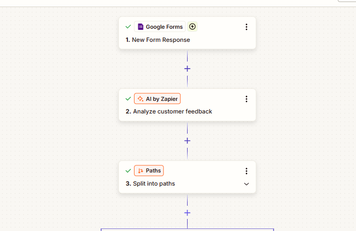
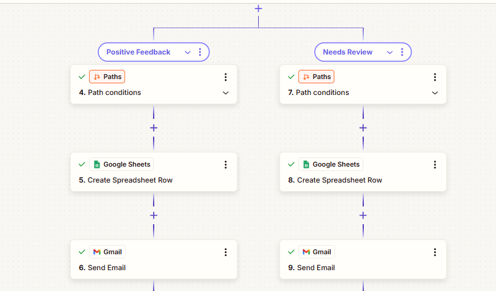
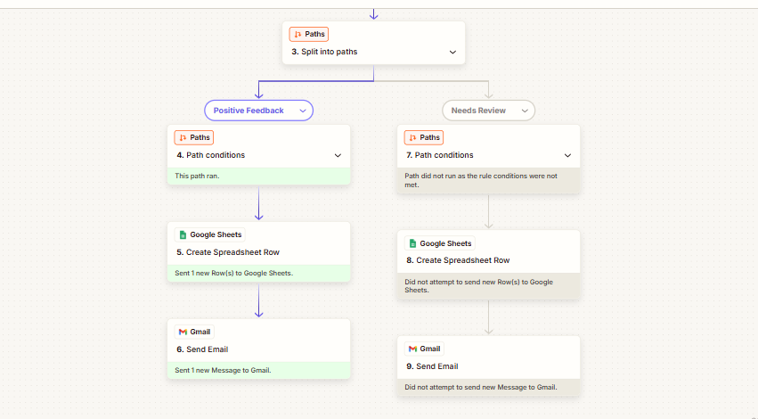
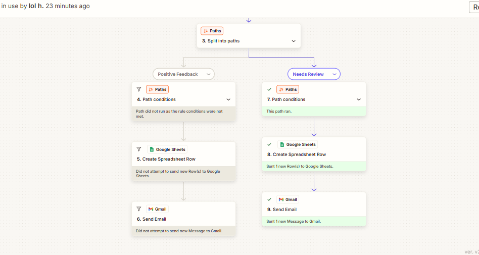

# 💬 AI Feedback Responder

An automation that receives customer feedback from a Google Form, uses AI to analyze its sentiment and draft a reply, then replies automatically to clearly positive feedback and sends everything else to a staff member for review.

---

## 🎯 Problem

### The Context
Companies receive customer feedback through online forms. Some feedback is a simple thank-you, while some contains complaints or mixed opinions that need careful handling.

### The Problem
Someone has to read every message, understand the customer's feeling, summarize it, write a reply, and decide whether it can be answered right away or needs a person. This is repetitive, and delays can make customers feel ignored.

### Why It Matters
- Positive feedback can be answered quickly without using staff time.
- Complaints and unclear feedback are not answered automatically by mistake.
- Every piece of feedback is recorded in one organized place.

---

## 💡 Solution

A Zapier workflow that analyzes each piece of feedback with AI, then routes it by sentiment into one of two paths: an automatic thank-you reply for positive feedback, or a review email to the team for everything else.

### What does the system do?
- Receives customer feedback from Google Forms.
- Uses AI by Zapier to detect the sentiment, summarize the feedback, and draft a reply.
- Routes the feedback into one of two paths.
- Logs every feedback record in Google Sheets.
- Sends an email through Gmail: a thank-you to the customer, or a review request to staff.

---

## 👤 Users

**Primary Users:**
- Customer support or service team members who review feedback.
- Small businesses that want to respond to customers faster.

**User Need:**
- Answer positive feedback quickly without manual work.
- Be alerted to complaints and unclear feedback, with a summary and a ready draft reply.
- Keep a clear record of all feedback.

---

## 🧠 How I Designed the Solution

I followed the same principle used throughout the course:

| Role | Responsibility |
|---|---|
| AI | Understand the feedback (sentiment, summary, draft reply) |
| Rule / Logic | Control which path the feedback takes |
| Human | Review everything that is not clearly positive |

The routing decision is made by a simple rule, not by the AI's free judgment: only feedback with the exact sentiment `positive` is answered automatically.

---

## ⚙️ How It Works

```
Input: Customer feedback (Google Form)
  ↓
Trigger: New Form Response
  ↓
AI: Analyze customer feedback → sentiment, summary, suggested reply
  ↓
Logic: Split into paths by sentiment
  ├── sentiment = positive  →  Positive Feedback path
  │      ↓ Google Sheets (log)  →  Gmail (thank-you to the customer)
  └── anything else         →  Needs Review path
         ↓ Google Sheets (log)  →  Gmail (review email to staff)
  ↓
Output: Logged record + email sent
```

---

## 🤖 Role of AI

### What does AI do in this solution?
- Classifies the sentiment as `positive`, `negative`, or `unclear`.
- Writes a one-sentence summary of the feedback.
- Drafts a short, polite reply.

### What AI Should NOT Do
- Invent details the customer did not mention.
- Promise refunds, discounts, or deadlines in a reply.
- Decide the routing: the path is chosen by the rule, not by the AI.

---

## 🔄 Automation

What parts of the process are automated?
- Starting the workflow when a new form response arrives.
- Analyzing the feedback with AI.
- Splitting the feedback into the correct path.
- Logging every record in Google Sheets.
- Sending the email: a thank-you to the customer for positive feedback, or a review email to staff for everything else.

---

## 🗂️ Data

### Input
Customer name, customer email, and the feedback text (free text).

### Output
A row in Google Sheets with the name, email, feedback, sentiment, summary, and suggested reply, plus an email notification.

---

## 🛠️ Tools & Technologies

| Tool | Purpose |
|---|---|
| Google Forms | Receiving customer feedback |
| Zapier | Building the automation workflow |
| AI by Zapier | Analyzing sentiment, summarizing, and drafting replies |
| Paths by Zapier | Routing feedback by sentiment |
| Google Sheets | Recording all feedback and results |
| Gmail | Sending emails to customers and staff |

---

## 🔑 Key Design Decisions

### Decision 1
**Decision:**
Only feedback with sentiment exactly equal to `positive` is answered automatically. Negative, unclear, or mixed feedback goes to a staff member.

**Why:**
An automatic reply to a complaint can make things worse. Sending uncertain cases to a person is safer than guessing.

### Decision 2
**Decision:**
Keep the workflow to two paths only, and make the second path catch everything that is not positive.

**Why:**
This keeps the logic simple and makes sure no feedback is lost, even if the AI returns an unexpected value.

---

## 🧪 Testing

### Test 1
**Input:**
> The product is great and delivery was fast.

**Expected Result:**
Sentiment is `positive`. The Positive Feedback path runs, a row is added to Google Sheets, and a thank-you email is sent.

**Actual Result:**
The AI returned `positive`, with a one-sentence summary and a polite suggested reply. The Positive Feedback path ran, the Needs Review path was skipped, a row was added to Google Sheets, and an email was sent through Gmail.

**Status:** ✅

### Test 2
**Input:**
> My order arrived two weeks late and nobody replied to my emails.

**Expected Result:**
Sentiment is not `positive`. The Needs Review path runs, a row is added to Google Sheets, and a review email is sent to the staff member.

**Actual Result:**
After fixing the path condition (see Challenges), the Needs Review path ran, the Positive Feedback path was skipped, a row was added to Google Sheets, and a review email was sent through Gmail.

**Status:** ✅

---

## 📸 Evidence

### Workflow



### Positive Feedback path ran


### Needs Review path ran



---

## ⚠️ Challenges & Failures

### What didn't work as expected?
- When I tested negative feedback for the first time, neither path ran. Both showed "Path did not run as the rule conditions were not met", so nothing was logged and no email was sent.

### How did I solve it?
- I found that the Needs Review path had a condition that did not match negative feedback. I changed it so it catches every feedback that is not `positive`, then re-ran the same response and confirmed it worked.

---

## 📚 What I Learned

### Technical Lesson
How to connect Google Forms, AI by Zapier, Paths, Google Sheets, and Gmail, and how a path that catches "everything else" prevents requests from being dropped.

### Problem-Solving Lesson
When a workflow stops, look at which step ran and which did not. In this case, the run history showed that both paths were skipped, which pointed directly to the path condition.

### AI Lesson
AI is useful for understanding free text, but the routing decision should come from a clear rule. A strict instruction (return exactly one of three values) makes the output easy to route.

---

## 🔮 Future Improvements

If I continued developing this project, I would:
- Add a review step before any reply is sent to customers.
- Support feedback written in Arabic and other languages.
- Send an immediate alert for very negative feedback.
- Log technical failures and notify the team when a step fails.
- Measure how often the sentiment classification is correct.

---

## 🔗 Project Links

**Workflow:** [add your Zapier link here]

**Repository:** [add your GitHub link here]

---

## 👩‍💻 Author

**Hiba Hijazy**

[LinkedIn](https://www.linkedin.com/in/hiba-hijazy-57b7a642a) · [GitHub](https://github.com/hiiibahh-25)
